# Optimal Control of an Acrobot: swing-up, LQR and MPC tracking

**Closed-loop Newton trajectory optimisation, time-varying LQR and constrained MPC for an underactuated double pendulum — Python, parameter Set 3.**

This project started as a group assignment for the *Optimal Control* course of my M.Sc. in Automation Engineering
(University of Bologna, 2025/26). Afterwards I re-implemented it from scratch, added verification, and pushed the
optimiser until the swing-up problem actually converges. This document is the technical report of that version.

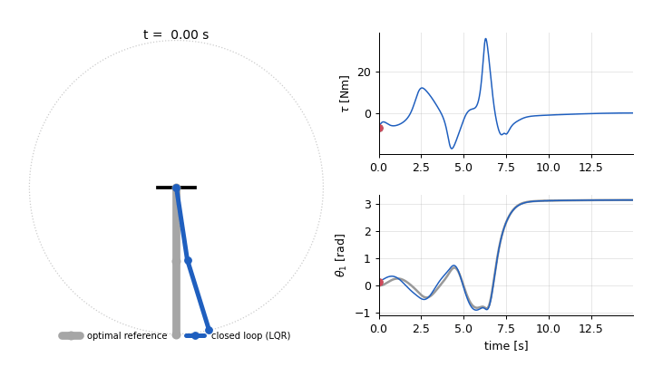

*The 15 s swing-up from hanging down to upright. Grey: optimal reference trajectory. Blue: robot tracked by the LQR from a perturbed initial state.*

## Contents

1. [Summary of results](#1-summary-of-results)
2. [Model](#2-model)
3. [Discretisation and linearisation](#3-discretisation-and-linearisation)
4. [Optimal control problem and algorithm](#4-optimal-control-problem-and-algorithm)
5. [Task 1 — transition between two equilibria](#5-task-1--transition-between-two-equilibria)
6. [Task 2 — swing-up](#6-task-2--swing-up)
7. [Task 3 — LQR tracking](#7-task-3--lqr-tracking)
8. [Task 4 — MPC tracking, with and without torque limits](#8-task-4--mpc-tracking-with-and-without-torque-limits)
9. [Task 5 — animation](#9-task-5--animation)
10. [Comparison with the original course code](#10-comparison-with-the-original-course-code)
11. [Verification](#11-verification)
12. [Limitations](#12-limitations)
13. [How to run](#13-how-to-run)
14. [Repository layout](#14-repository-layout)

---

## 1. Summary of results

All numbers are produced by the `run_taskN.py` scripts and stored in `results/*.json`.

| | Result |
|---|---|
| Task 1, transition θ₁ = −15° → +15° | converged in **6** iterations, ‖Δu‖ = 8·10⁻¹², cost 1 881 → 10.34 |
| Task 2, swing-up (θ₁: 0 → π, 15 s) | converged in **242** iterations (≈ 50 s), ‖Δu‖ = 3·10⁻⁷, cost 76 838 → **19 614**; final state θ₁ = π − 6.5·10⁻⁴ rad, θ₂ ≈ −2·10⁻⁴ rad, velocities ≈ 10⁻³ rad/s; peak torque **36.6 Nm** |
| Task 3, LQR from 3 perturbed starts | max \|e_θ₁\| = 0.10 / 0.17 / 0.21 rad; final ‖e‖ ≤ 4·10⁻⁵ |
| Task 4, MPC (horizon 20 samples = 0.2 s) | same errors as the LQR (trajectories differ by ≤ 3.4·10⁻⁶) |
| Task 4, torque limit ±30 Nm | respected; max \|e_θ₁\| = 0.10 rad, final ‖e‖ = 1.7·10⁻⁶ |
| Task 4, torque limit ±25 Nm | respected; max \|e_θ₁\| = 0.15 rad, final ‖e‖ = 1.5·10⁻⁴ |
| vs. original course code (same cost function) | cost after optimisation **19 614 vs 34 115** (see [§10](#10-comparison-with-the-original-course-code)) |

## 2. Model

The Acrobot is a planar double pendulum with a motor **only at the second joint** (the "hip" of a gymnast on a bar).
State and input:

$$x = [\theta_1,\ \theta_2,\ \dot\theta_1,\ \dot\theta_2]^\top, \qquad u = \tau \quad(\text{torque on joint 2}),$$

with θ₁ measured from the downward vertical (θ₁ = 0 hanging, θ₁ = π upright) and θ₂ relative to the first link.
The Euler–Lagrange equations are

$$M(\theta)\,\ddot\theta + C(\theta,\dot\theta)\,\dot\theta + F\,\dot\theta + G(\theta) = \begin{bmatrix}0\\ \tau\end{bmatrix},$$

$$M=\begin{bmatrix} I_1+I_2+m_1 l_{c1}^2+m_2(l_1^2+l_{c2}^2+2l_1l_{c2}\cos\theta_2) & I_2+m_2l_{c2}(l_1\cos\theta_2+l_{c2})\\ I_2+m_2l_{c2}(l_1\cos\theta_2+l_{c2}) & I_2+m_2l_{c2}^2\end{bmatrix},$$

$$C=\begin{bmatrix} -m_2l_1l_{c2}\dot\theta_2\sin\theta_2 & -m_2l_1l_{c2}(\dot\theta_1+\dot\theta_2)\sin\theta_2\\ m_2l_1l_{c2}\dot\theta_1\sin\theta_2 & 0\end{bmatrix},\quad F=\begin{bmatrix}f_1&0\\0&f_2\end{bmatrix},$$

$$G=\begin{bmatrix} g\,l_{c1}m_1\sin\theta_1+g\,m_2\big(l_1\sin\theta_1+l_{c2}\sin(\theta_1+\theta_2)\big)\\ g\,m_2l_{c2}\sin(\theta_1+\theta_2)\end{bmatrix}.$$

**Parameters.** The tutor prescribed **Set 3** of the assignment; it is the default everywhere
(`acrobot/params.py` also contains Sets 1 and 2).

| m₁ = m₂ | l₁ = l₂ | l_c1 = l_c2 | I₁ = I₂ | g | f₁ = f₂ |
|---|---|---|---|---|---|
| 1.5 kg | 2.0 m | 1.0 m | 2.0 kg m² | 9.81 m/s² | 1.0 N m s/rad |

## 3. Discretisation and linearisation

* **RK4** with a step of dt = 10 ms: x₍ₜ₊₁₎ = f(xₜ, uₜ). Energy conservation without friction is part of the tests.
* **Exact Jacobians** A = ∂f/∂x and B = ∂f/∂u along a trajectory by the *complex-step* derivative,
  ∂f/∂xⱼ = Im f(x + i·h·eⱼ)/h with h = 10⁻³⁰. There is no subtractive cancellation, so the Jacobians are accurate to
  machine precision (checked against central finite differences in the tests).
* Second derivatives of f (needed by the Newton method, §4) are central differences of these exact Jacobians.
* Whole trajectories are linearised in one vectorised call; the line search and closed-loop simulations use a pure-Python scalar RK4 (≈10× faster than NumPy on 4-vectors, verified against the vectorised version).

## 4. Optimal control problem and algorithm

For a reference curve $(x^{\rm des}, u^{\rm des})$ over T samples the optimiser solves

$$\min_{u_0,\dots,u_{T-2}}\ \sum_{t=0}^{T-2}\tfrac12\|x_t-x^{\rm des}_t\|_Q^2+\tfrac12\|u_t-u^{\rm des}_t\|_R^2\;+\;\tfrac12\|x_{T-1}-x^{\rm des}_{T-1}\|_{Q_T}^2\quad\text{s.t. } x_{t+1}=f(x_t,u_t),\ x_0\ \text{given}.$$

**Closed-loop Newton method** (what Task 1 of the assignment asks for). Each iteration k:

1. Roll out the current input, linearise along the trajectory, compute the cost gradient with the adjoint recursion.
2. Solve the affine LQ problem of the Newton step with a backward Riccati recursion (DDP-style, including the second derivatives of the dynamics). This gives feedback gains $K_t$ and feed-forward terms $\sigma_t$. A Levenberg-type term μ is added to the Hessian in the input direction and increased automatically whenever the step is not a descent direction (it stays 0 in all runs reported here).
**3. Armijo backtracking line search on the closed-loop update**

$$u^{+}_t=u_t+K_t\,(x^{+}_t-x_t)+\gamma\,\sigma_t,\qquad x^{+}_{t+1}=f(x^{+}_t,u^{+}_t),$$

with γ = 1, ½, ¼, … until $J^{+}\le J+c\,\gamma\,\nabla J^\top\Delta u$ (c = 10⁻⁴, β = ½). The feedback term keeps the new trajectory close to the point where the model was linearised, which is what makes the method work on a long, unstable swing-up. The plain open-loop update $u+\gamma\Delta u$ only admits tiny steps there.
**4. Stop** when ‖Δu‖ < 10⁻⁶ (Δu is the open-loop descent direction obtained by simulating the linearised closed loop).

The initial guess is **zero torque** in all experiments ("worst-case" initialisation).

## 5. Task 1 — transition between two equilibria

**Equilibria.** With zero velocities and accelerations the dynamics reduce to G₁(θ) = 0 and τ = G₂(θ). Fixing θ₁ and solving for (θ₂, τ) with a root finder gives, for Set 3,

| θ₁ | θ₂ | holding torque |
|---|---|---|
| −15° | +65.94° | +11.43 Nm |
| +15° | −65.94° | −11.43 Nm |

**Reference.** Hold (3.75 s) → smooth cubic transition (2.5 s) → hold (3.75 s), symmetric in time, T = 10 s; the reference torque is the holding torque along the curve.
Weights: Q = diag(1, 1, 0.1, 0.1), R = 0.01, Q_T = 1000·Q.

**Result.** Converged in 6 iterations (cost 1 881 → 10.34, ‖Δu‖ 337 → 8·10⁻¹²). The convergence is super-linear, as expected for a Newton method.
The optimal trajectory stays within 0.08 rad (θ₁), 0.13 rad (θ₂), 0.13 rad/s (θ̇₁) and 0.38 rad/s (θ̇₂) of the desired curve; peak torque 11.9 Nm.

| Optimal trajectory vs desired curve | Intermediate iterates |
|---|---|
| 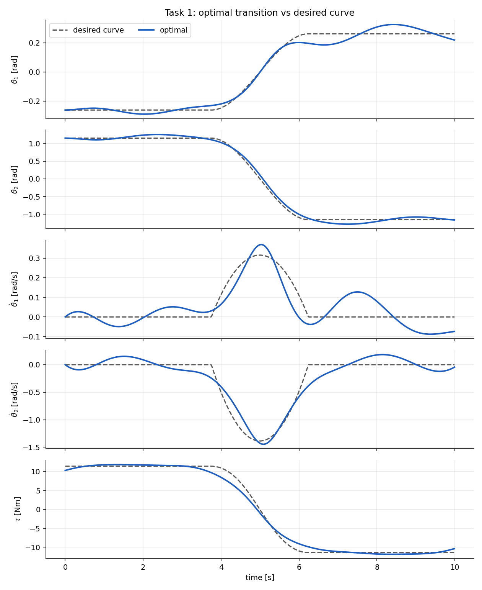 | 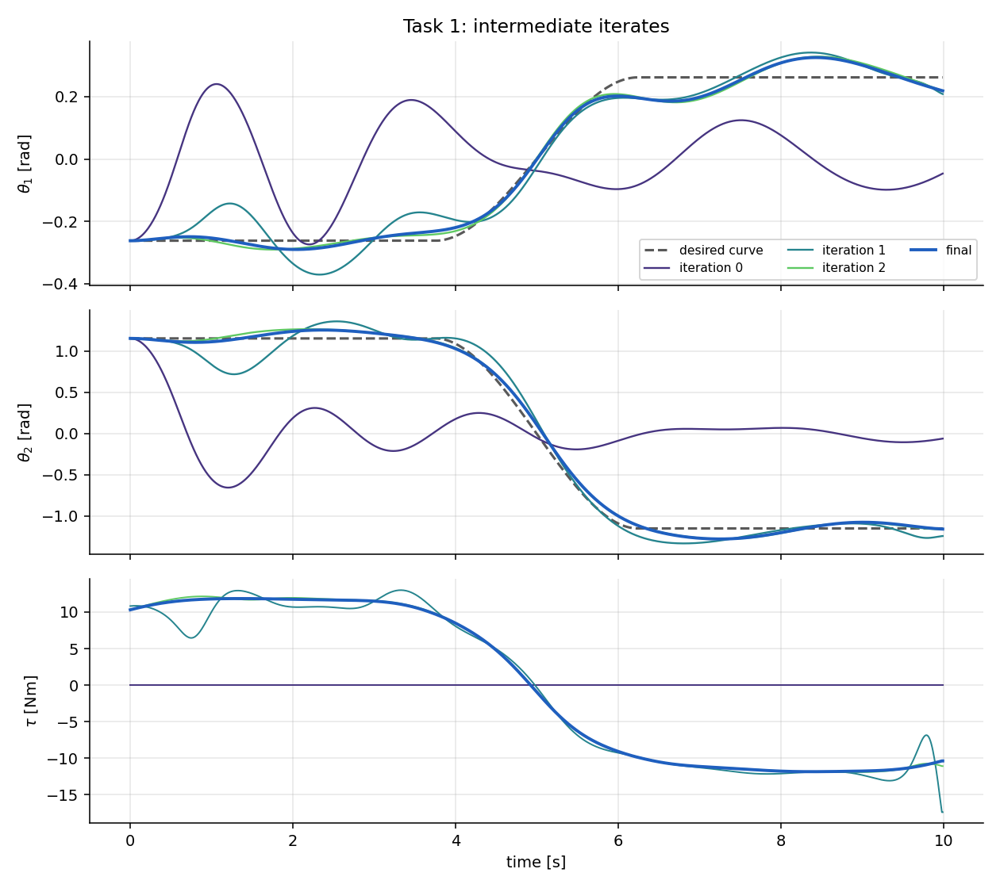 |

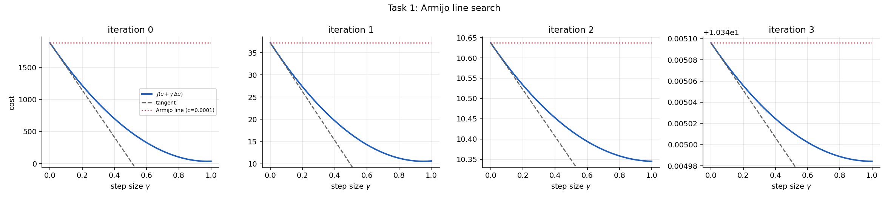

*Armijo plot: cost along the search direction J(u + γΔu) (blue), its tangent (dashed) and the Armijo line (dotted) for the first iterations and the last informative one. In iterations 0–2 the full step γ = 1 is accepted.*

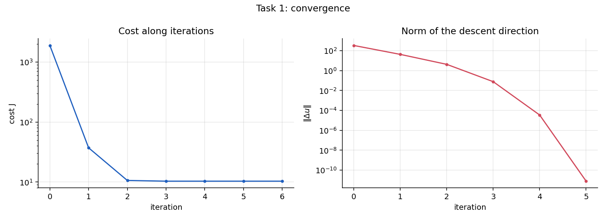

**Discussion.** The desired curve is a smooth path between two *unstable* equilibria and is not dynamically feasible, so the optimal trajectory deviates from it, especially in the second hold phase where it oscillates around the target. This is a genuine property of the weights (tracking error is traded against control effort), not a convergence problem: the final ‖Δu‖ is 10⁻¹².

## 6. Task 2 — swing-up

**Problem.** Bring the Acrobot from rest, hanging down (θ₁ = 0, θ₂ = 0), to rest, upright (θ₁ = π, θ₂ = 0) in 15 s (T = 1500 samples). The *desired curve* is a smooth cubic θ₁ path from 0 to π with θ₂ = 0 and zero torque. It is deliberately naive: the optimiser has to discover the energy-pumping swing by itself.
Weights: Q = diag(10, 10, 1, 1), R = 0.1, Q_T = diag(10⁴, 10⁴, 10³, 10³); initial guess u ≡ 0.

**Result** (`results/task2_summary.json`)

| quantity | value |
|---|---|
| iterations to ‖Δu‖ < 10⁻⁶ | 242 (162 of them needed backtracking, γ < 1) |
| cost | 76 838 → 19 614 |
| final state | θ₁ = 3.1409 rad (π − 6.5·10⁻⁴), θ₂ = −2.2·10⁻⁴ rad, θ̇₁ = −1.5·10⁻³, θ̇₂ = −6.3·10⁻⁴ rad/s |
| θ₁ within 0.1 rad of π from | t = 8.54 s |
| peak torque | 36.6 Nm at t = 6.3 s |
| max \|θ₂\|, \|θ̇₁\|, \|θ̇₂\| | 2.52 rad, 4.20 rad/s, 6.24 rad/s |
| control effort ∫τ² dt | 917 N²m²s |

| iteration | 0 | 1 | 5 | 20 | 50 | 100 | 150 | 200 | 242 |
|---|---|---|---|---|---|---|---|---|---|
| cost | 76 838 | 54 557 | 48 992 | 40 590 | 34 201 | 25 650 | 21 248 | 19 880 | 19 614 |

The cost decreases monotonically (guaranteed by the line search). ‖Δu‖ does not decrease monotonically — it rises and falls several times (245, 283, 7, 14, 91, 88, 59, 33, … at iterations 0, 1, 5, 20, 50, 100, 150, 200) before collapsing to 3·10⁻⁷ in the last iterations — which is typical for a Newton method on a strongly nonlinear, non-convex problem and is why a few hundred iterations are needed here, whereas Task 1 needs six.

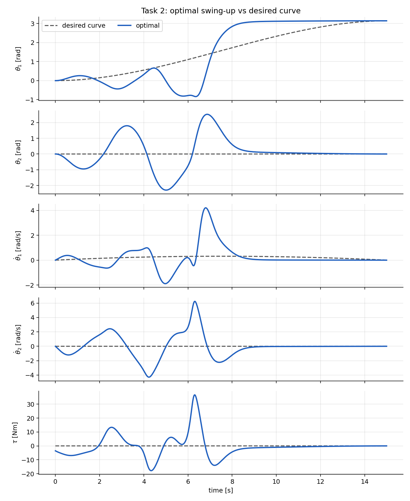

*The optimal swing-up (blue) leaves the naive desired curve (dashed) completely: the robot swings both links back and forth several times, building up energy, and then throws θ₁ over the top around t = 6–8 s with a peak torque of 36.6 Nm. After that the (unstable) upright equilibrium is approached smoothly.*

| Intermediate iterates | Convergence |
|---|---|
| 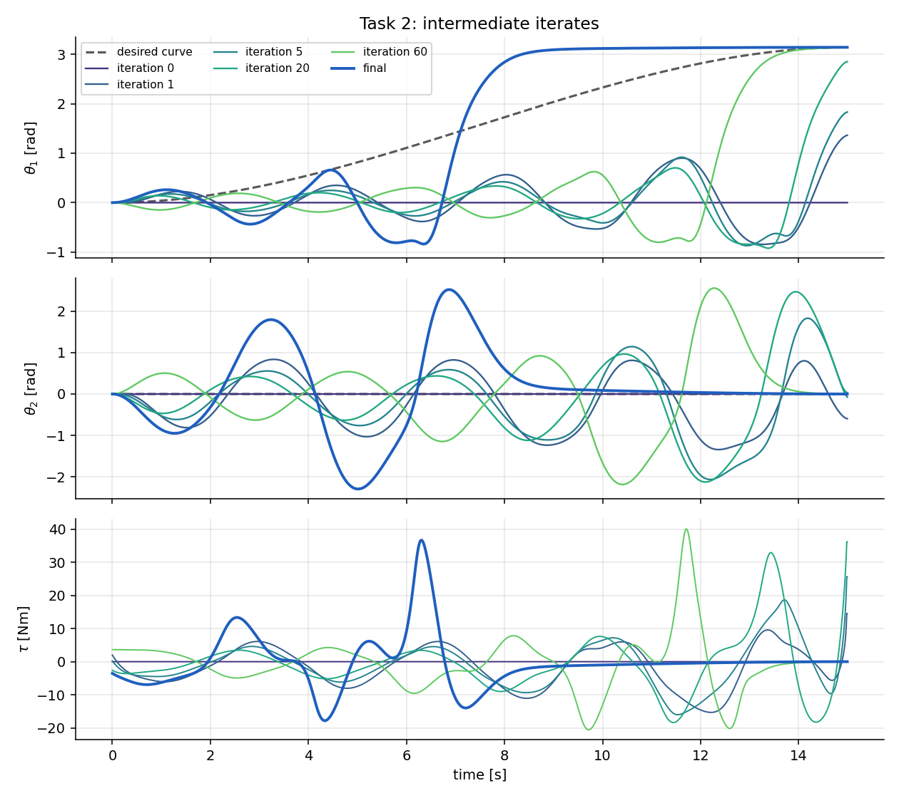 | 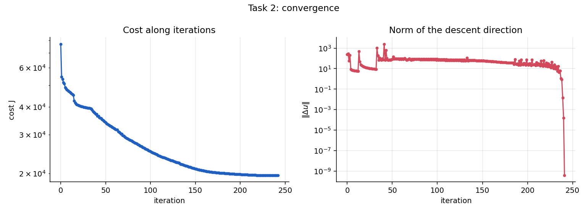 |

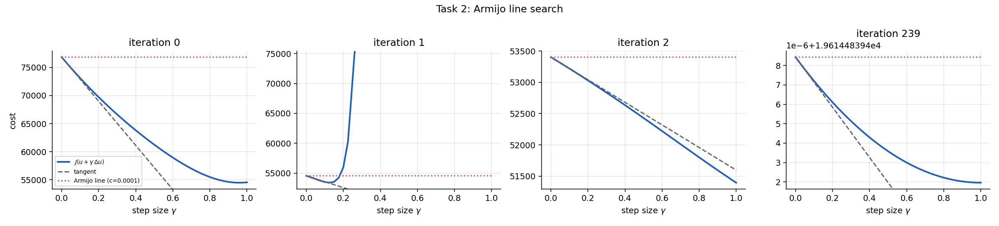

*Armijo plots: iteration 1 shows a case where the full step is rejected (the cost explodes for γ > 0.2) and the line search backtracks to a smaller step.*

**Discussion.** The cost value (≈ 2·10⁴) is dominated by the unavoidable deviation from the naive desired curve; it is not a measure of how well the swing-up works — the final-state error is. The result is a **local** minimum found from a zero-torque initial guess.

## 7. Task 3 — LQR tracking

**Formulation.** Linearise the dynamics about the generated trajectory $(x^{\rm gen},u^{\rm gen})$ of Task 2 and solve the finite-horizon LQ problem

$$\min \sum_{t=0}^{T-2}\Delta x_t^\top Q^{\rm reg}\Delta x_t+\Delta u_t^\top R^{\rm reg}\Delta u_t+\Delta x_{T-1}^\top Q_T^{\rm reg}\Delta x_{T-1},\qquad \Delta x_{t+1}=A_t\Delta x_t+B_t\Delta u_t.$$

The time-varying gains $K_t$ give the control law $u_t=u^{\rm gen}_t+K_t\,(x_t-x^{\rm gen}_t)$, which is applied to the **nonlinear** plant.
Weights: Q^reg = diag(1000, 1000, 10, 10), R^reg = 1, Q_T^reg = 10·Q^reg.

**Scenarios** (initial state = $x^{\rm gen}_0$ + perturbation):

| scenario | perturbation | max \|e_θ₁\| | final ‖e‖ | peak torque |
|---|---|---|---|---|
| position error | (0.10, −0.10, 0, 0) | 0.100 rad | 1.5·10⁻⁶ | 36.2 Nm |
| velocity error | (0, 0, 0.5, −0.5) | 0.165 rad | 5.8·10⁻⁶ | 36.9 Nm |
| mixed error | (0.15, 0.15, 0.2, 0.2) | 0.206 rad | 3.8·10⁻⁵ | 35.6 Nm |
| no error | 0 | 0 | 0 | 36.6 Nm |

In every case the error is driven to (numerically) zero, including at the unstable upright equilibrium.

| Trajectories | Tracking error |
|---|---|
| 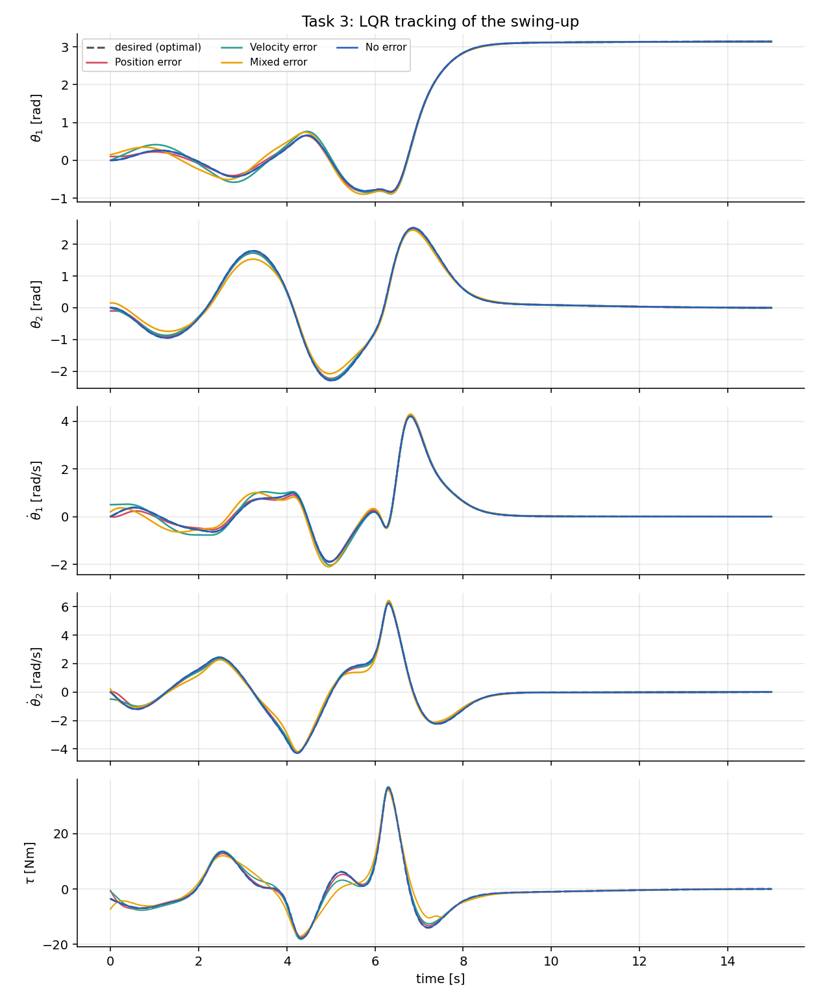 |  |

## 8. Task 4 — MPC tracking, with and without torque limits

**Formulation.** At every sample t the LQ problem over the next N = 20 samples (0.2 s)

$$\min \sum_{k=0}^{N-2}\Delta x_k^\top Q\,\Delta x_k+\Delta u_k^\top R\,\Delta u_k+\Delta x_{N-1}^\top P_{t+N}\,\Delta x_{N-1}\quad\text{s.t. }\Delta x_{k+1}=A_k\Delta x_k+B_k\Delta u_k,\ \ \Delta x_0=x_t-x^{\rm gen}_t,\ \ u_{\min}\le u^{\rm gen}_{t+k}+\Delta u_k\le u_{\max}$$

is condensed into a dense QP and solved with **qpOASES** (through CasADi); only Δu₀ is applied. Without limits the QP is solved in closed form.
Weights are those of the LQR. Because the swing-up is unstable, a plain terminal weight (10·Q) makes the short window lose the swing-up; I therefore use as terminal weight P₍ₜ₊N₎ the **cost-to-go of the full-horizon LQ problem**. With it, unconstrained MPC and the Task-3 LQR coincide (trajectories differ by ≤ 3.4·10⁻⁶, which is also a test).

**Unconstrained MPC** gives the same errors as the LQR in all scenarios (§7).

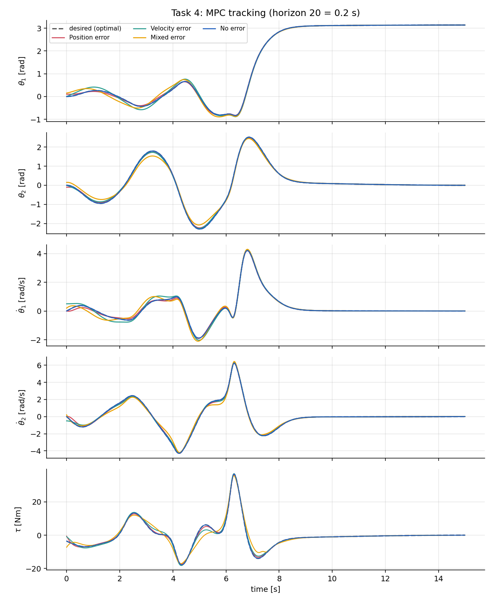

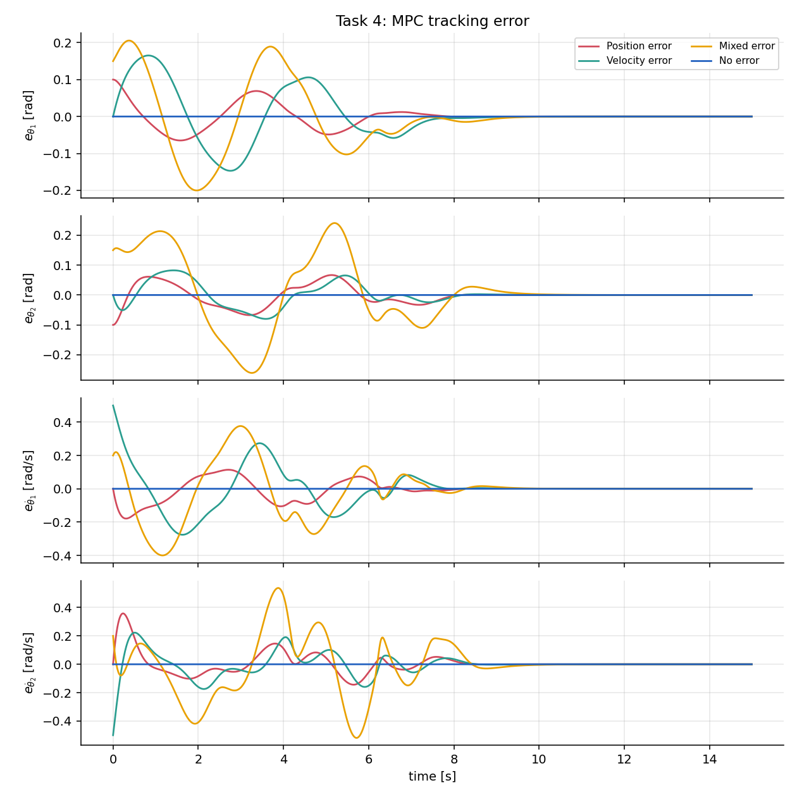

**Constrained vs unconstrained** (position-error start). The generated swing-up needs 36.6 Nm, so a limit of 30 or 25 Nm clips the reference itself for a short time around t ≈ 6.3 s.

| | peak torque | max \|e_θ₁\| | final ‖e‖ | samples at the limit | solver fall-backs |
|---|---|---|---|---|---|
| unconstrained | 36.2 Nm | 0.100 rad | 1.5·10⁻⁶ | – | – |
| \|τ\| ≤ 30 Nm | 30.0 Nm | 0.100 rad | 1.7·10⁻⁶ | 37 | 0 |
| \|τ\| ≤ 25 Nm | 25.0 Nm | 0.149 rad | 1.5·10⁻⁴ | 114 | 0 |

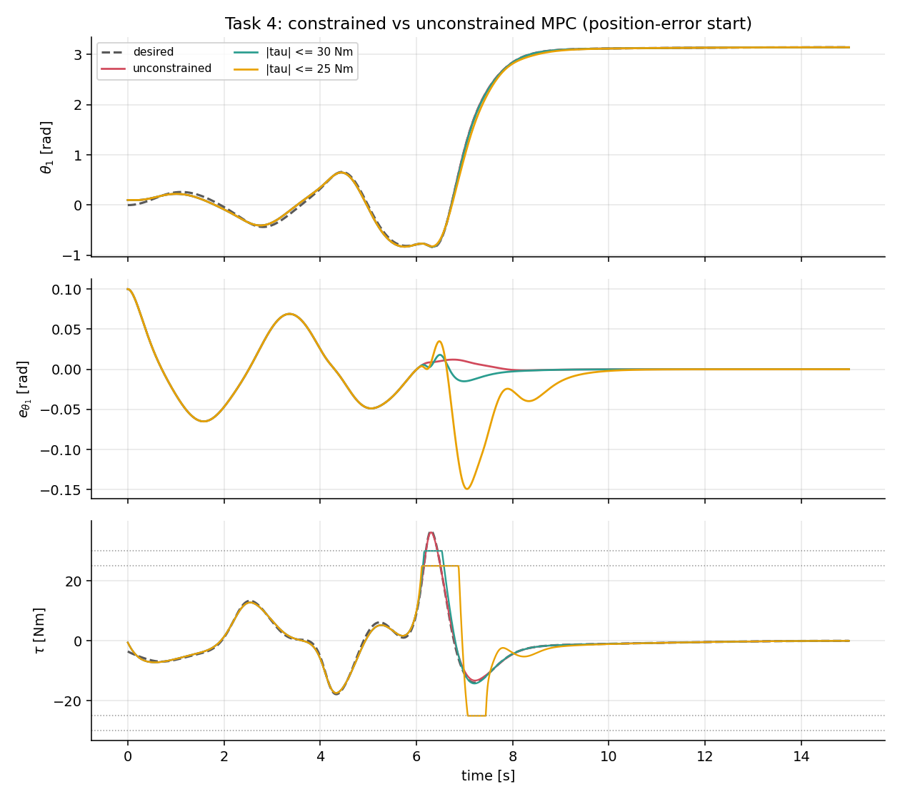

The limits are respected exactly. At 30 Nm the tracking is essentially unaffected; at 25 Nm the robot lags behind the reference during the throw (error up to 0.15 rad) but the MPC re-plans and still ends up on the upright equilibrium with an error of 1.5·10⁻⁴.

## 9. Task 5 — animation

`python run_task5.py` opens an interactive window (SPACE pause/play, ←/→ ±0.1 s, R restart, ESC quit); the grey robot is the optimal reference, the blue one the closed loop from the mixed-error start. `python run_task5.py --gif` / `--mp4` write `results/task5_swing_up.gif` / `.mp4` (video with torque and θ₁ traces, used for the animation at the top of this page).

## 10. Comparison with the original course code

The original course code (flat scripts, open-loop line search `u + γΔu`, Gauss–Newton direction, finite-difference Jacobians) was re-run with the same Set 3 parameters, the same cost weights, zero-torque initial guess and the 80-iteration budget of its `main_task2.py`. Raw numbers: `docs/baseline_open_loop_cost.csv`.

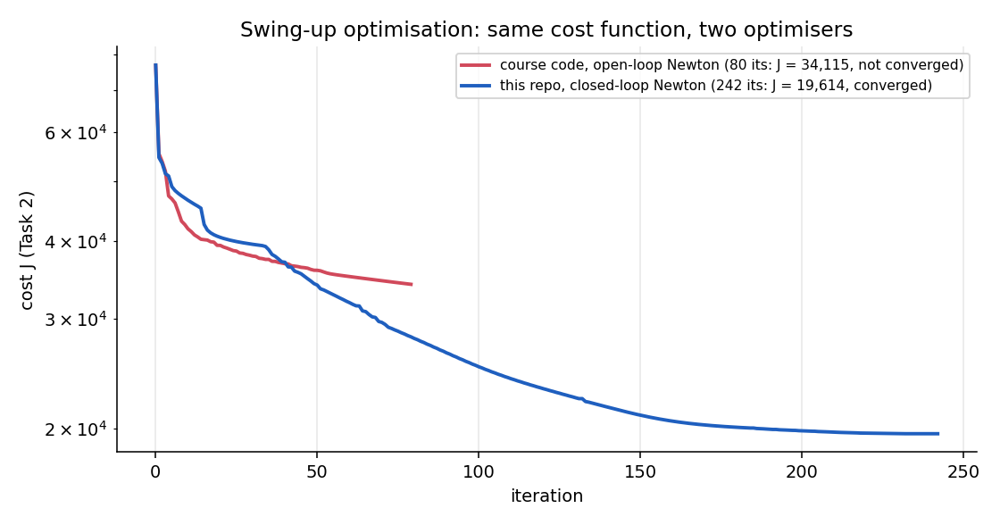

| | original course code | this repository |
|---|---|---|
| Newton variant | Gauss–Newton, open-loop step | full Newton (2nd derivatives of the dynamics), **closed-loop step** |
| iterations | 80 (budget) | 242 (until ‖Δu‖ < 10⁻⁶) |
| state at the end | not converged: ‖Δu‖ ≈ 25.6, step size ½ | converged: ‖Δu‖ = 3·10⁻⁷ |
| cost J | 34 115 | **19 614** (−43 %) |
| time | ≈ 2.5 min | ≈ 50 s |
| Jacobians | finite differences | complex-step (exact) |

Reading the comparison fairly: for the first ≈ 40 iterations both optimisers decrease the cost at a similar rate; the difference is that the new one keeps making progress, while the open-loop version had already slowed down to a crawl (step size ½, ‖Δu‖ constant at ≈ 25) when its budget ran out. The cost function is identical; the only difference in the problem data is that the initial velocity of the desired curve is set to exactly zero here (initial cost 76 838 instead of 76 807). I did not test whether the original code would eventually converge with a much larger iteration budget.

## 11. Verification

`python -m pytest` runs 10 tests (≈ 3 s):

* the pure-Python RK4 step equals the vectorised one (1e-12);
* the two equilibria are fixed points of the discrete dynamics;
* energy is conserved without friction and input;
* complex-step Jacobians match central finite differences;
* Newton converges on Task 1 and the finite-difference gradient of J at the solution is ≈ 0 (stationarity);
* the cost decreases monotonically along the iterations;
* LQR recovers the swing-up from a perturbation (open loop with the same torques does not);
* unconstrained MPC coincides with the LQR;
* the MPC respects its torque limits and the QP solver never falls back.

The numbers above are reproducible: Task 1 gives identical iteration logs on different machines; for Task 2 the iteration count varies by a few (e.g. 242 on one machine, 247 on another) because of floating-point differences in the BLAS/LAPACK libraries, with the same final cost (19 614.48).

## 12. Limitations

* **Local optimum.** The swing-up problem is non-convex; the result is the local minimum reached from a zero-torque initial guess. Other initial guesses may give other swing-ups.
* **Desired curves are not dynamically feasible** (Tasks 1 and 2) and the weights trade tracking error against effort, so the optimum is not on the desired curve.
* **Torque.** The swing-up needs 36.6 Nm. With limits of 30/25 Nm in Task 4 the *reference* itself exceeds the limit; the MPC copes by re-planning around the saturation, but the resulting trajectory is not the optimal one for the limited actuator. A swing-up planned with the limit in the optimiser (constrained trajectory optimisation) is not implemented.
* **Linearisation about the generated trajectory** only (as required); there is no re-linearisation about the actual state in the MPC.
* No measurement noise or model mismatch is simulated.

## 13. How to run

```bash
python -m venv .venv
.venv\Scripts\activate            # Windows;  macOS/Linux: source .venv/bin/activate
pip install -r requirements.txt

python run_task1.py               # each task opens its figures in windows (and saves them to results/figures)
python run_task2.py               # ≈ 1 min; caches results/swing_up_trajectory.npz for Tasks 3-5
python run_task3.py
python run_task4.py
python run_task5.py               # interactive animation (pygame)
python run_comparison.py          # figure of §10
python -m pytest
```

Figures are always saved as PNG; add `--no-show` (or set `ACROBOT_NO_SHOW=1`) to open no windows, e.g. on a server.
Weights, horizons, scenarios and torque limits are in `acrobot/config.py`, robot parameters in `acrobot/params.py`.
If the cached swing-up is missing, Task 2 is recomputed automatically.

## 14. Repository layout

```
acrobot/
  params.py        parameter Sets 1-3
  dynamics.py      model, RK4, complex-step Jacobians, fast scalar step
  newton.py        closed-loop Newton method with Armijo line search
  references.py    equilibria and desired curves (Tasks 1-2)
  tracking.py      time-varying LQR and MPC (condensed QP, qpOASES)
  plotting.py      all figures        animation.py   GIF/MP4 and pygame viewer
  config.py        weights and settings   pipeline.py   shared helpers
run_task1.py ... run_task5.py, run_comparison.py
tests/             pytest suite
docs/              baseline numbers of the original course code
results/           figures, JSON summaries, cached swing-up, GIF/MP4
```

MIT licence.
